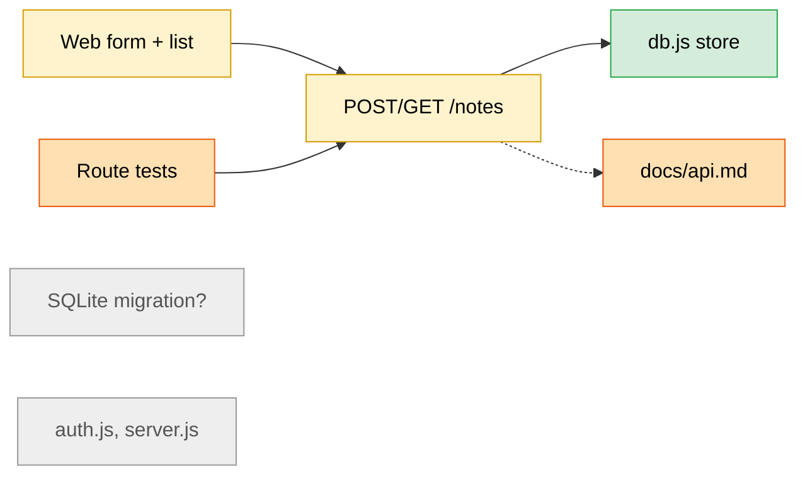
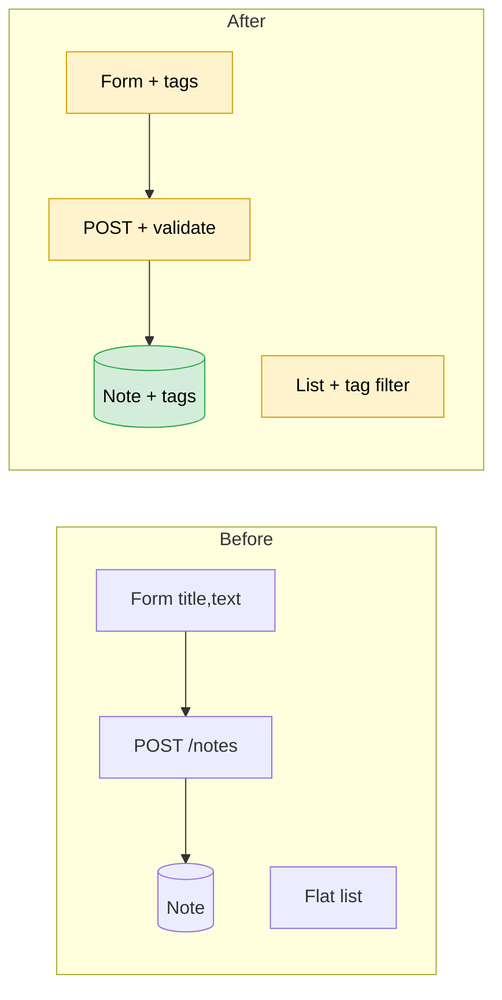
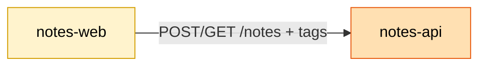
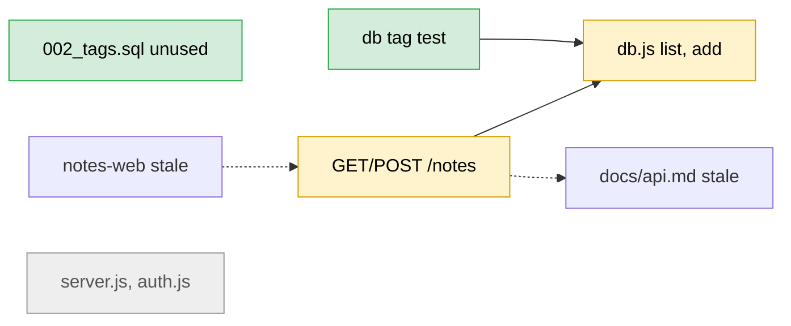
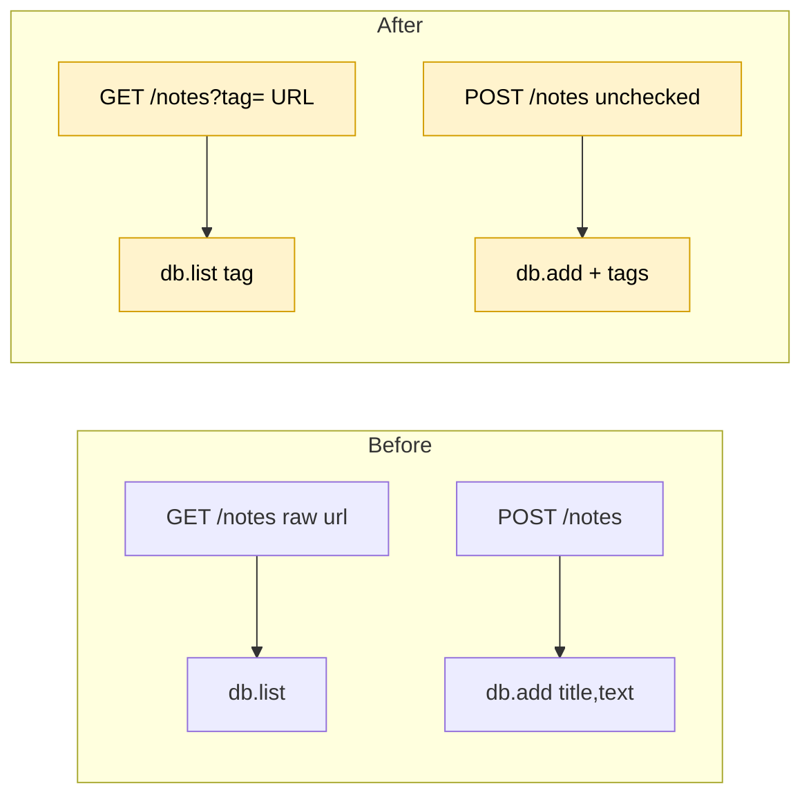

<!-- Example output: BEFORE then AFTER on the test fixtures (tests/fixtures). Made by test runs T1 and T3. -->

<!-- blast-radius:before id=idea-add-tags-notes version=1 date=2026-11-27 -->
## Blast radius: Add tags to notes

**Size L** · confidence medium · 6 file(s) · 2 repo(s) · security M · findings 2 high, 5 medium, 3 low · source: text

> **WHAT**: Notes get a list of tags when they are made, and the web app can filter its list to one tag. Done when `POST /notes` with `{title, text, tags: ["work"]}` returns the tags, `GET /notes` returns them, bad tags get 400, and in the web app: add 2 notes, tag one "work", pick "work", and only that note shows.
> **WHY**: The list is one flat list with no way to group notes, so users who keep many notes cannot find them. Tags let them find a note fast. (guess)
> **Other way**: Filter in the browser, over the list `GET /notes` already returns. The API then only stores and returns tags: no query parameter, no tags table, no new route. This report sizes that way.
> **Top findings**: F1 bad JSON in `POST /notes` crashes the API process · F2 the API key is in client code · F3 `POST /notes` stores input with no checks; tags would be a new unchecked input

### Impact map

Green S · yellow M · orange L · red XL · grey no change

### Open questions

1. Filter on the server (`GET /notes?tag=work`) or in the browser? This report sizes the browser. The server way adds `notes-web/src/api.js`, a query parameter in `docs/api.md`, and the F4 fix.
2. Can users add tags to a note that already exists? There is no update route today (`notes-api/src/routes/notes.js:9-12`). If yes, a new `PATCH /notes/:id` route is needed, and Design goes to L.
3. What is a tag: free text or a fixed list? What limits (tags per note, length) and is the match case-sensitive?
4. Is the SQLite store real? `notes-api/src/db.js:1` says the deploy uses SQLite, but no code runs `src/migrations/001_init.sql` (F8). If it is real, tags need a `002` migration.
5. Who asked for tags, and what problem do they have? The ticket gives no reason, so WHY is a guess.

Impact: size per part

| Part | Size | Notes |
|---|---|---|
| Files | L | 6 change, 0 new, 0 delete, 3 maybe. 6 files is M, but 2 repos with real work make it at least L. (seen) |
| Design | M | A new `tags` field on the note, a new validation function in the route, and a tag filter and tag input in `app.js`. Not L: no module's public interface breaks, and `db.add` keeps its callers. (seen) L if tags can be added to existing notes (new PATCH route). (guess) |
| Architecture | S | No new module, layer, store, or dependency. Tags ride on the note through the existing GET and POST flow. (seen) L if tags get their own table. (guess) |
| Contracts | L | `docs/api.md` changes: the POST body and both responses get `tags`. Old clients still work, because the API drops unknown fields today. (run) Not XL: nothing breaks for old clients. |
| Risk | L | Data writes through a route with no tests (F6), on a POST path that can crash the process today (F1). (run) Not XL: no deploy path change, and the store is in memory. |
| Security | M | A new array field from the client goes into the store. Checks are easy to add with `readJson` in `src/http.js` and a small validator (F3). Not L: no change to auth, secrets, CORS, or what user data goes out. (seen) L if tags go in with no checks. (guess) |
| Tests | L | No route has a test today (F6). notes-api needs route tests for POST with tags and with bad tags. (seen) XL if notes-web needs automated tests: it has no test setup. (seen) |
| Rollback | S | `git revert` in each repo and deploy. Either order works, because the API drops unknown fields. (run) M if a `002` SQLite migration ships with tag data. (guess) |

Overall: L, from the biggest parts (Files, Contracts, Risk). Only 3 of the 6 parts are L, so not XL.

**Before → after**

**Cross-repo flow**

The contract is `notes-api/docs/api.md`. `notes-api/AGENTS.md:12` says both repos must match it.

Fit: project rules (2 follow, 5 break, 1 unclear)

Sources: `notes-api/.blast-radius/standards.md`, `notes-api/AGENTS.md`. Not found: CLAUDE.md, CONTRIBUTING.md, ADRs, lint or format config, `.editorconfig`; notes-web has no rule files.

Checklist for the person who does the work. "breaks" means the code in the touched area breaks the rule today; the work should fix it in the lines it touches.

| Rule | Source | Status | Where |
|---|---|---|---|
| All HTTP input is checked. Bad input returns 400, never crashes. Check `tags` too. | `.blast-radius/standards.md` (must) | breaks now (F1, F3) | `notes-api/src/routes/notes.js:4`, `:10` |
| No secrets in client code. Add none in the tag work. | `.blast-radius/standards.md` (must) | breaks now (F2) | `notes-web/src/config.js:2` |
| Every route has a test. | `.blast-radius/standards.md` (should) | breaks now (F6) | `notes-api/test/notes.test.js:5` |
| Routes parse the URL with `new URL()`. | `.blast-radius/standards.md` (should) | breaks now (F4) | `notes-api/src/routes/notes.js:9-11` |
| Use `src/http.js` helpers for JSON bodies and responses. | `.blast-radius/standards.md` (should) | breaks now (F7) | `notes-api/src/routes/notes.js:3-8` |
| Layers: routes -> db. Tag storage and any filter go in `db.js`, not the route. | `.blast-radius/standards.md` (architecture) | follows | `notes-api/src/routes/notes.js:1` |
| The API shape is in `docs/api.md`; both repos match it. Update it in the same change. | `notes-api/AGENTS.md:12` | unclear: decided by whether the work updates `docs/api.md:7-8` | `notes-api/docs/api.md:7-8` |
| Show note data with `textContent`, never `innerHTML`. Do the same for tag text. | pattern | follows | `notes-web/src/app.js:7` |

Findings: health and security (10)

| ID | Sev | Kind | Where | What | Fix |
|---|---|---|---|---|---|
| F1 | high | security | `notes-api/src/routes/notes.js:4` | Now: bad JSON in `POST /notes` throws in `readBody`; the rejection is not caught and the process exits with code 1. Anyone with the key (see F2) can stop the API. (run) | Use `readJson` from `src/http.js`; return 400 when it gives `null`. Fix it first, in its own ticket or the first commit. |
| F2 | high | security | `notes-web/src/config.js:2` | Now: the API key is in client code, so every browser gets it. It is the same as the server's built-in fallback at `notes-api/src/auth.js:2`, used when `API_KEY` is not set; the `Dockerfile` sets none. (seen) | Separate ticket: remove the fallback, set `API_KEY` at deploy, and stop shipping the key to the browser. |
| F3 | medium | security | `notes-api/src/routes/notes.js:10` | Now: POST stores the body with no checks: `title: 123` gets 201, and `text` can be missing. (run) `tags` would be a new input with no type, count, or length limit. | Add a validator: title is a string, tags is an array of short strings with a max count (named constants); else 400. |
| F4 | medium | bug | `notes-api/src/routes/notes.js:9` | Now: raw compare on `req.url`, so `GET /notes?tag=work` returns 405. (run) Blocks a server-side filter. | Parse with `new URL(req.url, 'http://localhost')` and match `pathname`. Needed only if the filter is on the server. |
| F5 | medium | bug | `notes-web/src/app.js:8` | Now: a click anywhere on a note deletes it, with no confirm. A clickable tag inside the `li` would pass the click up and delete the note. (seen) | Move delete to its own button. Keep tag clicks from reaching the `li` handler. |
| F6 | medium | standard | `notes-api/test/notes.test.js:5` | Now: only `db.add` and `db.list` are tested; no route has a test. The test checks a global count (`length, 1`), so a second test in this file that adds a note breaks it. (seen) | Add route tests (call `createServer()` and send requests); check counts relative to the start. |
| F7 | medium | duplication | `notes-api/src/routes/notes.js:3-8` | Now: `readBody` and `json()` copy `readJson` and `sendJson` in `src/http.js:2-8`, without the parse guard. (seen) | Delete the copies; import from `src/http.js`. |
| F8 | low | smell | `notes-api/src/migrations/001_init.sql:1` | Now: `db.js:1` says the deploy uses SQLite, but no code runs this migration; the `Dockerfile` runs the in-memory store. (seen) | Answer open question 4: delete the migration, or add the code that runs it plus a `002` for tags. |
| F9 | low | bug | `notes-api/src/server.js:13` | Now: importing `server.js` throws when `process.argv[1]` is undefined (for example under `node -e`). (run) Route tests that import it under `node --test` are fine. | Use `process.argv[1]?.endsWith(...)` or an `import.meta` check. |
| F10 | low | smell | `notes-web/src/api.js:3-5` | Now: no `r.ok` check, so a 400 from the new tag checks comes back as if it were a note, and the user sees nothing. (seen) | Check `r.ok` and show the error message. |

2 more, low: `DELETE /notes/:id` returns 204 for an id that does not exist (`notes-api/src/routes/notes.js:12`); typo "Not foud" (`notes-api/src/server.js:9`).

Reuse: `readJson` and `sendJson` at `notes-api/src/http.js:2-8`; the `db` object pattern at `notes-api/src/db.js:4-8` for storing and filtering tags; `FormData` reading at `notes-web/src/app.js:14` for the tag input; `textContent` rendering at `notes-web/src/app.js:7` for tag text.

Files (6)

| Group | File | Why | Tag |
|---|---|---|---|
| change | `notes-api/src/routes/notes.js` | Read and check `tags` in POST; reuse `src/http.js` | seen |
| change | `notes-api/src/db.js` | Store `tags` on the note in `add` | seen |
| change | `notes-api/docs/api.md` | Add `tags` to the POST body and both responses | seen |
| change | `notes-api/test/notes.test.js` | Tests for tags in `db` and in the POST route | seen |
| change | `notes-web/index.html` | Tag input in the form; a tag filter control | seen |
| change | `notes-web/src/app.js` | Send tags, show tags, filter the list | seen |
| maybe | `notes-web/src/api.js` | If the filter is on the server: `listNotes(tag)` | guess |
| maybe | `notes-api/src/migrations/002_tags.sql` (new) | If the SQLite store is real | guess |
| maybe | `notes-api/AGENTS.md` | Lists the calls notes-web makes (line 7); if a new route or query is added | guess |

Not changed (seen): `notes-api/src/server.js` (`startsWith('/notes')` at line 8 already passes `/notes?tag=` to the route), `notes-api/src/http.js` (reuse as is), `notes-api/src/auth.js`, `notes-web/src/config.js`, `notes-api/Dockerfile`, `notes-api/.github/workflows/ci.yml` (`npm test` already runs new tests).

Measured in notes-api (the current repo, with 4 of the 6 files). notes-web was read only, from the map in `notes-api/AGENTS.md:7`.

Made by blast-radius v0.3.0

<!-- blast-radius:after id=idea-add-tags-notes version=1 date=2026-11-27 -->
## Blast radius AFTER: Add tags to notes

**Size L** (guess was L) · confidence high · accuracy 57% · 4 file(s) · 1 repo(s) · security L · findings 1 high, 5 medium, 1 low · now 1 high, 1 medium, 3 low · PR: branch feat/tags (no PR)

> **WHAT check**: partly. The API stores tags, returns them, and filters with `GET /notes?tag=`. Bad tags do not get 400, `docs/api.md` is not updated, and notes-web has no tag input or filter yet.
> **FIT check**: 3 of 7 rules followed. Worst break: `tags` is not checked, and one bad value can crash the API (F1).
> **Biggest surprise**: the filter went to the server (`?tag=`, open question 1), not the browser way the BEFORE report sized. A SQLite migration was added, but no code runs it (F7).
> **Top findings**: F1 `tags: null` plus `GET /notes?tag=x` crashes the API · F3 `tags` has no type, count, or length check · F4 `docs/api.md` not updated

### Impact map (real)

Green S · yellow M · orange L · red XL · grey no change · dashed grey: should have changed (stale)

**Before → after**

Guess vs real

| Part | Guess | Real | Diff | Notes |
|---|---|---|---|---|
| Files | L | M | -1 | 3 change, 1 new, 0 delete, 1 repo. The guess had 2 repos; notes-web has no change yet (F5). Report file not counted. (seen) |
| Design | M | M | same | `db.list(tag)` gets a parameter, `db.add` takes `tags`, the GET route reads the query. No public module interface breaks. (seen) |
| Architecture | S | S | same | No new module or dependency. `002_tags.sql` adds a `note_tags` table that no code uses, so it is a finding (F7), not L. (seen) |
| Contracts | L | L | same | `GET /notes` gets `?tag=`, POST and both responses get `tags`; old clients still work. The contract doc must change and did not (F4). (run) |
| Risk | L | L | same | Data writes through a route with no route tests, and a new crash path (F1). (run) Not XL: no deploy path change, the store is in memory. |
| Security | M | L | +1 | A new input path (`tags`) with no checks (F1, F3). (run) Not XL: the crash needs the API key; any visitor has it only through the old key-in-client hole (BEFORE F2), and old holes do not raise the size. |
| Tests | L | L | same | The diff adds 1 `db` test. The change still needs the first route tests: `?tag=`, POST with tags, bad tags (F6). (seen) |
| Rollback | S | S | same | `git revert` and deploy. Not M: no code runs `002_tags.sql`, so no database holds the table. (seen) M if someone runs migrations by hand. (guess) |

Overall: L, from Contracts, Risk, and Security. Only 3 of the 6 parts are L, so not XL.

- Hits (4): `src/routes/notes.js`, `src/db.js`, `test/notes.test.js`, `src/migrations/002_tags.sql` (a "maybe" in the guess)
- Surprises (0)
- Missed (3): `docs/api.md` (still to do, F4), `notes-web/index.html` and `notes-web/src/app.js` (still to do, F5)
- Maybe, not changed: `notes-web/src/api.js` (now needed: the filter is on the server, so `listNotes(tag)`), `AGENTS.md:7` (lists the calls notes-web makes; add `?tag=` when notes-web uses it)
- Not committed (0)
- Checks: not run (no --run-checks)
- Accuracy 57% (fair). The guess had the right API files. The misses are the docs and the whole notes-web side, which is not started.

Fit: project rules (3 follow, 4 break)

Sources: `.blast-radius/standards.md`, `AGENTS.md`, the BEFORE checklist. Not found: CLAUDE.md, CONTRIBUTING.md, ADRs, lint or format config.

| Rule | Source | Diff | Where |
|---|---|---|---|
| All HTTP input is checked. Bad input returns 400, never crashes. | `.blast-radius/standards.md` (must) | breaks (F1, F3) | `src/routes/notes.js:11`, `src/db.js:5-6` |
| No secrets in client code. | `.blast-radius/standards.md` (must) | follows: the diff adds none | - |
| Every route has a test. | `.blast-radius/standards.md` (should) | breaks (F6) | `test/notes.test.js:10-13` |
| Routes parse the URL with `new URL()`. | `.blast-radius/standards.md` (should) | follows on the changed GET line; POST and DELETE still compare raw `req.url` (F9) | `src/routes/notes.js:9-12` |
| Use `src/http.js` helpers for JSON bodies and responses. | `.blast-radius/standards.md` (should) | breaks (F8): the new GET line uses the local `json()` copy | `src/routes/notes.js:8,10` |
| Layers: routes -> db. Filter in `db.js`. | `.blast-radius/standards.md` (architecture) | follows | `src/db.js:5` |
| The API shape is in `docs/api.md`; both repos match it. | `AGENTS.md:12` | breaks (F4) | `docs/api.md:7-8` |

Not checked: "show note data with `textContent`" (pattern, notes-web): notes-web has no change yet.

Findings: health and security (12)

| ID | Sev | Kind | Where | What | Fix |
|---|---|---|---|---|---|
| F1 | high | bug | `src/db.js:5` | `POST /notes` with `tags: null` (or a number) gets 201. The next `GET /notes?tag=x` throws a TypeError in `n.tags.includes`; the rejection is not caught and the process exits with code 1. (run) | Check `tags` in POST (array of strings); return 400 else. |
| F2 | high | security | `src/routes/notes.js:4` | Now: bad JSON in `POST /notes` still throws in `readBody` and the process exits with code 1. (run) Same as BEFORE F1; the diff did not fix it. | Use `readJson` from `src/http.js`; return 400 on `null`. Separate ticket or first commit. |
| F3 | medium | security | `src/routes/notes.js:11` | `tags` goes into the store with no type, count, or length check. `tags: "work"` (a string) is stored, and `?tag=or` then matches it by substring. (run) | One validator: array, max count and length as named constants, strings only. |
| F4 | medium | should-change | `docs/api.md:7-8` | The contract has no `tags` in POST body or responses, and no `?tag=` on GET. `AGENTS.md:12` says both repos must match it. (seen) | Add `tags` and `?tag=` to `docs/api.md` in this branch. |
| F5 | medium | should-change | `notes-web/src/app.js:15` | notes-web has no change: no tag input, no tag display, no filter. WHAT says the web app filters by tag. (seen) | Do the notes-web part (`index.html`, `app.js`, `api.js` `listNotes(tag)`), or split it into its own ticket. |
| F6 | medium | standard | `test/notes.test.js:10-13` | No route test for `GET /notes?tag=`, POST with tags, or bad tags. The new test counts a global `'work'` list, so any other test that adds a `'work'` note breaks it. (seen) | Add route tests with `createServer()`; count relative to the start. |
| F7 | medium | should-change | `src/migrations/002_tags.sql:1` | Adds a `note_tags` table that no code runs or reads; tags live on the in-memory note (`src/db.js:6`). It also disagrees with that shape. (seen) | Drop it, or add the code that runs migrations and uses the table. |
| F8 | medium | duplication | `src/routes/notes.js:3-8` | Now: local `readBody` and `json()` copy `readJson` and `sendJson` in `src/http.js:2-8`. The diff adds a new call to the copy (line 10). (seen) | Import from `src/http.js`; delete the copies. |
| F9 | low | smell | `src/routes/notes.js:10-12` | The same path match is done two ways: GET uses `u.pathname`, POST and DELETE compare raw `req.url`. `POST /notes?x=1` gets 405. (run) | Use `u.pathname` for all three. |
| F10 | low | bug | `src/routes/notes.js:13` | Now: `DELETE /notes/:id` returns 204 for an id that does not exist. (seen) | Return 404 when `db.remove` gives `false`. |

2 more, low (Now): typo "Not foud" (`src/server.js:9`); importing `src/server.js` throws when `process.argv[1]` is undefined (`src/server.js:13`).

Still open from BEFORE, outside the touched area: F2 (API key in client code, `notes-web/src/config.js:2`, fallback `src/auth.js:2`), F5 (click on a note deletes it), F10 (no `r.ok` check in `notes-web/src/api.js`).

Fixed by this diff: BEFORE F4 for GET (`GET /notes?tag=work` no longer returns 405).

Files (4)

| Group | File | Why | Tag |
|---|---|---|---|
| change | `src/routes/notes.js` | GET parses the URL and passes `tag` to `db.list` | seen |
| change | `src/db.js` | `list(tag)` filter; `add` stores `tags` | seen |
| change | `test/notes.test.js` | One `db` test for the tag filter | seen |
| new | `src/migrations/002_tags.sql` | `note_tags` table; no code uses it (F7) | seen |

Not counted: `docs/blast-radius/idea-add-tags-notes.md` (the BEFORE report, committed on this branch).
Not changed (seen): `src/server.js` (`startsWith('/notes')` passes `?tag=` through), `src/http.js`, `src/auth.js`, `Dockerfile`, `.github/workflows/ci.yml`.

Made by blast-radius v0.3.1
