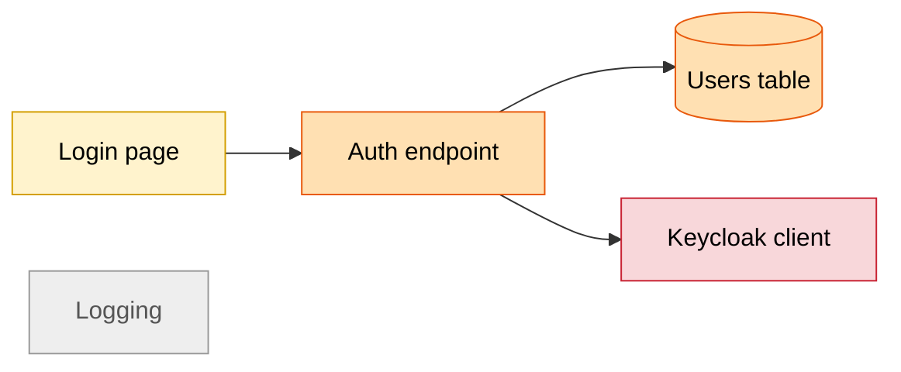
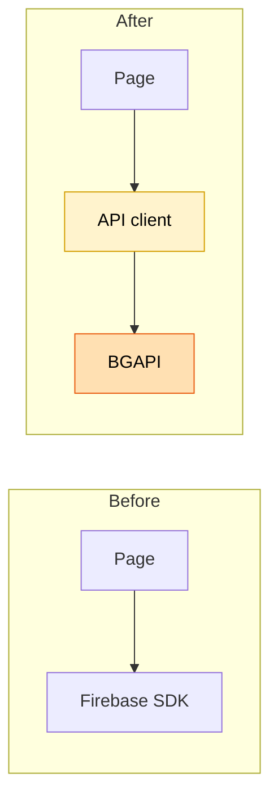
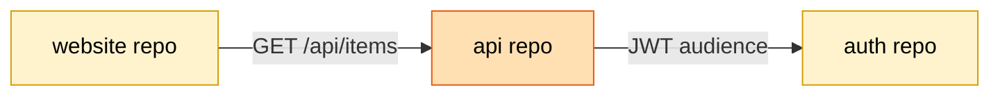

# Diagrams

Small diagrams only. They show where the change lands, not the whole system.

## Rules

- Max 10 boxes per diagram. If there are more, group them (for example "5 route files").
- Max 4 words per label.
- Color by how much that box changes: S green (a small edit), M yellow (new functions or fields), L orange (a new module, or a contract change), XL red (a rewrite, or a breaking change). A box gets the biggest size of the parts it touches (Design, Architecture, Contracts). Example: a route box with Design M that changes a public API (Contracts L) is L. Things that do not change: grey. "Maybe" items: grey with a dashed border.
- Use `flowchart LR` (left to right). It fits in a comment.
- In Azure DevOps comments and in the chat, use the ASCII form. Mark the size in brackets: `[L]`.
- Do not add a legend box. The colors are explained in one line under the diagram.

## Class lines (copy only the ones the diagram uses)

```
classDef s fill:#d4edda,stroke:#28a745,color:#000
classDef m fill:#fff3cd,stroke:#d39e00,color:#000
classDef l fill:#ffe0b2,stroke:#e8590c,color:#000
classDef xl fill:#f8d7da,stroke:#c82333,color:#000
classDef same fill:#eeeeee,stroke:#999999,color:#555
classDef maybe fill:#eeeeee,stroke:#999999,color:#555,stroke-dasharray: 5 5
classDef todo fill:#ffffff,stroke:#666666,color:#555,stroke-dasharray: 2 2
```

Use `maybe` for "maybe" files, for stale files in BEFORE (label ends with "stale"), and for a repo the change depends on (with a dashed arrow labelled "needs").

Use `todo` (white, dotted border) only in AFTER: a file or a whole repo that must change but the diff did not change it (Missed, or a should-change finding). The label ends with "to do". In ASCII, write `[to do]`, for example `notes-web [to do]`.

## 1. Impact map (always)

For an S change with 1 or 2 boxes, skip the diagram. Write one line instead:
`Impact: src/server.js [S] (404 text). Nothing else changes.`

The parts that change, and how they connect. Size per box.



ASCII form:

```
Login page [M] --> Auth endpoint [L] --> Users table [L]
                         |
                         +--> Keycloak client [XL]
```

## 2. Before → after (when Design or Architecture is M+)

Two groups side by side. Only the parts that differ, plus one neighbor for context.



ASCII form:

```
BEFORE:  Page --> Firebase SDK
AFTER:   Page --> API client [M] --> BGAPI [L]
```

## 3. Cross-repo flow (when 2+ repos are hit, or the change depends on another repo)

A repo that does not change but must do work first gets a dashed arrow labelled "needs".

One box per repo. Arrows are the contract between them, with the contract name on the arrow.



ASCII form:

```
website [M] --GET /api/items--> api [L] --JWT audience--> auth [M]
```

## AFTER mode

Draw the impact map from the real diff. Show work still to do with the `todo` class (see above). Mark surprises with a dashed border:

```
classDef surprise stroke-dasharray: 5 5
```

A box can have two classes: `X[Name]:::l:::surprise` does not work in all renderers. Use `class X l,surprise` on its own line instead.
